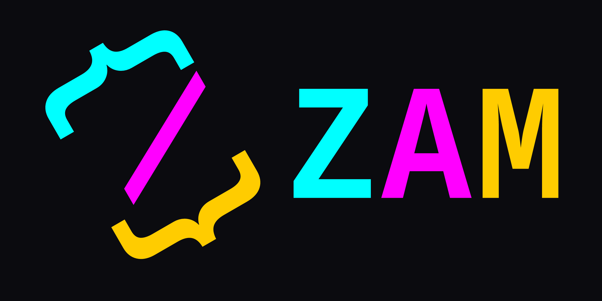

# Zam Programming Language

Zam is an imperative, multi-pass language featuring imperative interfaces, advanced generics, user-defined GC hooks, and inline struct-hack types.

```
import std("io/File.zam");
namespace Main {
    fun void(uint, str...) main = (argC, argV) {
        type(File).StdOut.WriteStr("Hello World!\n");
    }
}
```

## Getting Started
The best place to start is the [documentation](docs).

## TODO
Zam is far from complete.
* Implement the `std` package
    * Sync - Concurrency Primitives
    * Crypto - Cryptographic Primitives
    * Math - Mathematical Operations
    * IO - File System and Networking
    * Data - Data Structures
    * Lang - Language and System Primtives
    * Codec - Encoding and Compression
* Implement a testing framework
* Implement debugging
* Export LLVM instead of bytecode
* Bootstrap the language