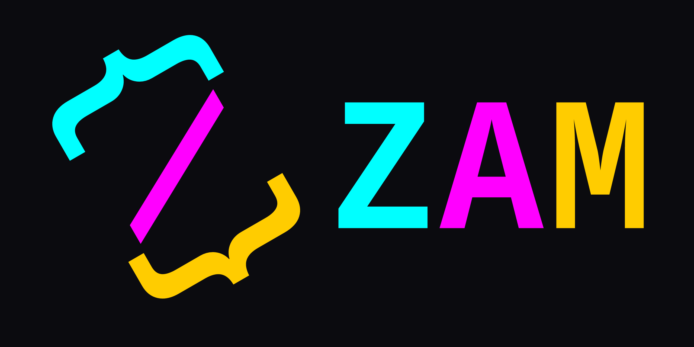

# Zam Programming Language

Zam is an imperative, multi-pass language featuring imperative interfaces, advanced generics, user-defined GC hooks, and inline struct-hack types.

```cpp
import std("io/File.zam");

namespace Main {
    fun void(uint, str...) main = (argC, argV) {
        File::StdOut.WriteStr("Hello World!\n");
    }
}
```

## Getting Started
The best place to start is the [documentation](docs).

## TODO
Zam is far from complete.
* Move to rust.
* Un-AI-ify the compiler, lsp, and debugger.
* Bootstrap the language.
